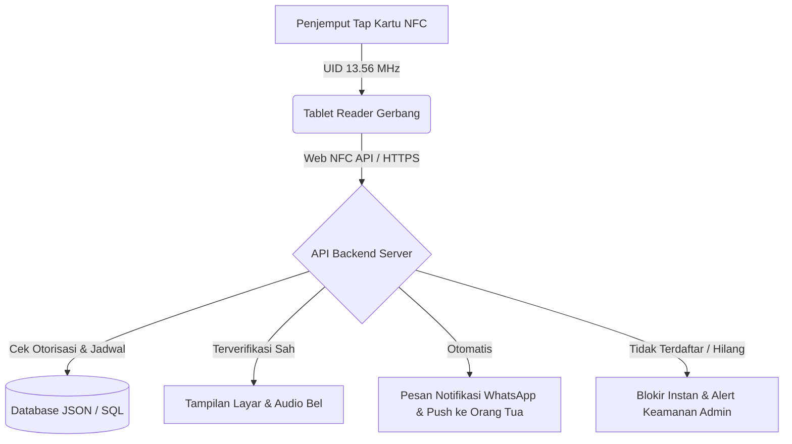

# 🛡️ Panduan Lengkap Implementasi JemputAman: Sistem Verifikasi Penjemputan Anak PAUD/TK Berbasis Kartu NFC

Dokumen ini berisi panduan teknis dan operasional lengkap untuk mengimplementasikan aplikasi **JemputAman** secara komprehensif di lingkungan sekolah PAUD dan TK, mulai dari persiapan perangkat keras (hardware NFC), instalasi server, konfigurasi HTTPS/SSL, hingga prosedur operasional di gerbang sekolah.

---

## 📋 Daftar Isi

1. [Gambaran Umum Sistem](#1-gambaran-umum-sistem)
2. [Spesifikasi & Kebutuhan Hardware NFC](#2-spesifikasi--kebutuhan-hardware-nfc)
3. [Panduan Instalasi & Setup Perangkat Lunak](#3-panduan-instalasi--setup-perangkat-lunak)
4. [Konfigurasi HTTPS & Izin Web NFC Browser](#4-konfigurasi-https--izin-web-nfc-browser)
5. [Prosedur Operasional Penjemputan di Sekolah](#5-prosedur-operasional-penjemputan-di-sekolah)
6. [Pengujian, Pemeliharaan & Troubleshooting](#6-pengujian-pemeliharaan--troubleshooting)

---

## 1. Gambaran Umum Sistem

**JemputAman** adalah sistem verifikasi penjemputan anak berbasis B2B SaaS multi-tenant yang dirancang khusus untuk PAUD dan TK. Sistem ini memverifikasi hak akses penjemput sah secara digital menggunakan kartu NFC fisik yang ditap pada perangkat tablet/HP guru piket di gerbang sekolah.



---

## 2. Spesifikasi & Kebutuhan Hardware NFC

### A. Kartu NFC Fisik (Untuk Penjemput & Murid)
- **Tipe Chip**: NTAG213, NTAG215, atau NTAG216 (Standard ISO/IEC 14443A Type 2 Tag).
- **Frekuensi Operasional**: 13.56 MHz.
- **Bentuk Fisik**: Kartu PVC tebal (seperti kartu ATM/ID Card) berukuran $85.60 \times 53.98\text{ mm}$ dengan cetakan *custom design* identitas sekolah JemputAman.
- **Estimasi Harga**: Rp 3.000 – Rp 6.000 per kartu.

### B. Perangkat Reader Gerbang (Tablet / HP Sekolah)
- **Sistem Operasi**: Android 8.1 (Oreo) atau lebih baru.
- **Fitur Hardware**: Wajib memiliki modul **NFC bawaan (Built-in NFC Chip)**.
- **Peramban Web (Browser)**: **Google Chrome v89+** untuk Android.
- **Rekomendasi Perangkat**: Tablet Android 8-10 inci (misal: Samsung Galaxy Tab A series dengan NFC) dipasang pada penyangga (*stand holder*) di meja piket gerbang kepulangan.

### C. Pembaca NFC Opsional untuk PC Admin (Registrasi Kartu di Kantor)
- **Model**: ACR122U USB Contactless Smart Card Reader.
- **Fungsi**: Membaca UID kartu NFC di PC Desktop Admin saat pendaftaran kartu baru.

---

## 3. Panduan Instalasi & Setup Perangkat Lunak

### Prasyarat Sistem Server
- **Node.js**: versi 20.x atau lebih baru.
- **npm**: versi 10.x atau lebih baru.
- **Git**: terinstal.

### Langkah 1: Kloning & Persiapan Proyek
```bash
# Masuk ke direktori proyek
cd C:\Users\LENOVO\jemput_aman
```

### Langkah 2: Instalasi Backend Service
```bash
cd backend
npm install
```

### Langkah 3: Konfigurasi Database Permanen
Aplikasi sudah dilengkapi modul simpan otomatis ke file JSON permanen di `backend/data/database.json`.
- Struktur folder data: `backend/data/`
- File database: `database.json` (otomatis dibuat dan diperbarui setiap ada transaksi pengetapan).

### Langkah 4: Menjalankan Server Backend
```bash
npm start
# Server berjalan di http://localhost:3000
```

### Langkah 5: Instalasi & Build Frontend Web Application
```bash
cd ../frontend
npm install
npm run build
```

---

## 4. Konfigurasi HTTPS & Izin Web NFC Browser

Peramban Google Chrome mengharuskan situs menggunakan **koneksi HTTPS aman (SSL)** agar fitur **Web NFC API (`NDEFReader`)** dapat aktif dan diizinkan mengakses modul hardware NFC.

### A. Akses Lokal dalam Jaringan WiFi Sekolah (Tanpa Internet Outbound)
1. Gunakan alat **mkcert** untuk membuat sertifikat SSL lokal:
   ```bash
   npx mkcert create-ca
   npx mkcert create-cert --domain localhost --domain 192.168.1.100
   ```
2. Jalankan peramban Chrome Android dan izinkan hak akses NFC:
   - Buka `chrome://flags/#enable-web-nfc` $\rightarrow$ set ke **Enabled**.
   - Buka Pengaturan Android $\rightarrow$ **NFC** $\rightarrow$ Pastikan status **ON**.

### B. Deployment Cloud Production (Rekomendasi Nginx + Let's Encrypt)
Gunakan Nginx sebagai Reverse Proxy dengan SSL gratis dari Certbot:

```nginx
server {
    listen 443 ssl http2;
    server_name jemputaman.sekolah.sch.id;

    ssl_certificate /etc/letsencrypt/live/jemputaman.sekolah.sch.id/fullchain.pem;
    ssl_certificate_key /etc/letsencrypt/live/jemputaman.sekolah.sch.id/privkey.pem;

    location / {
        proxy_pass http://localhost:5173;
        proxy_set_header Host $host;
        proxy_set_header X-Real-IP $remote_addr;
    }

    location /api/ {
        proxy_pass http://localhost:3000;
        proxy_set_header Host $host;
        proxy_set_header X-School-ID $http_x_school_id;
    }
}
```

---

## 5. Prosedur Operasional Penjemputan di Sekolah

### A. Pendaftaran Awal (Onboarding)
1. **Registrasi Murid**: Admin menginput nama anak, foto, kelas, dan kontak orang tua.
2. **Penautan Kartu NFC**:
   - Admin menempelkan kartu NFC baru pada reader.
   - UID unik kartu (misal: `04:A2:8B:12:FE:67:80`) otomatis terikat ke profil penjemput terdaftar (misal: Ayah/Supir).

### B. Operasional Jam Kepulangan (Verifikasi Gerbang)
1. **Petugas Piket**: Guru piket membuka halaman `Reader Gerbang` di tablet sekolah (`http://localhost:5173`).
2. **Pengetapan Kartu**:
   - Penjemput menempelkan kartu NFC ke bagian belakang tablet sekolah.
   - Pembaca Web NFC memproses kode UID dalam waktu $< 2\text{ detik}$.
3. **Hasil Verifikasi**:
   - **HIJAU (Terverifikasi Sah)**: Layar menampilkan foto siswa, foto penjemput, nama, dan timestamp. Notifikasi WhatsApp langsung terkirim ke Orang Tua.
   - **MERAH (Ditolak / Kartu Hilang)**: Layar menampilkan peringatan bahaya dan sinyal alarm. Guru piket wajib menahan siswa.

### C. Prosedur Darurat (Mode OTP Lupa Kartu)
1. Penjemput yang lupa membawa kartu melaporkan ke Guru Piket.
2. Guru Piket menekan tombol **"Mode Darurat OTP"** pada tablet gerbang.
3. Orang Tua menerima pemberitahuan dan memberikan approval 1-klik di aplikasi ponselnya (atau memberikan 6-digit kode OTP).
4. Kepulangan terverifikasi dengan metode `EMERGENCY_OTP`.

---

## 6. Pengujian, Pemeliharaan & Troubleshooting

### A. Pengujian Otomatis (Contract & Logic Tests)
Jalankan perintah pengujian pada folder `backend/`:
```bash
npm test
```
*Memastikan seluruh logika verifikasi NFC, penolakan kartu hilang, dan isolasi tenant sekolah berjalan 100% tanpa error.*

### B. Pertanyaan Umum & Troubleshooting (FAQ)

| Kendala | Penyebab Utama | Solusi Penanganan |
| :--- | :--- | :--- |
| **Pesan *"Web NFC API tidak didukung"*** | Membuka aplikasi di peramban selain Chrome Android atau tanpa HTTPS. | Pastikan menggunakan Google Chrome Android v89+ dan URL diawali `https://`. |
| **Kartu di-tap tetapi tidak ada respon** | Sensor NFC di tablet Android mati atau tertutup casing tebal. | Buka Settings Android $\rightarrow$ Aktifkan **NFC & Payment**, lepaskan casing logam/tebal. |
| **Notifikasi WhatsApp tidak terkirim** | Token gateway WhatsApp belum diatur di `.env`. | Perbarui `WHATSAPP_API_TOKEN` pada file `.env` di server backend. |
| **Kartu NFC Hilang** | Risiko digunakan pihak tak berwenang. | Masuk ke menu **Kelola Kartu** $\rightarrow$ Klik **Laporkan Hilang**. Akses kartu otomatis terblokir seketika. |

---

*Dokumen ini dibuat dan divalidasi untuk implementasi produksi sistem **JemputAman** (2026).*
