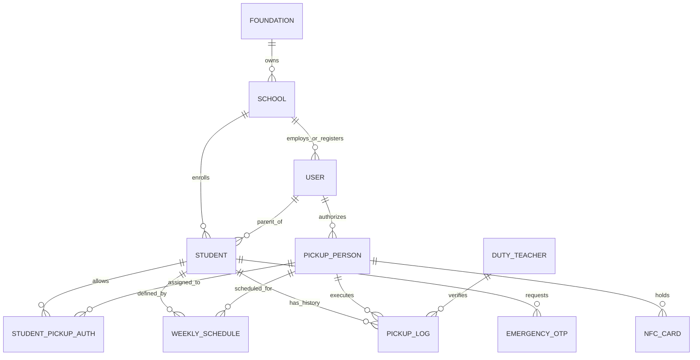

# Product Requirements Document (PRD) — JemputAman

**Nama Produk**: JemputAman — Sistem Verifikasi Penjemputan Anak PAUD/TK Berbasis Kartu NFC
**Tipe Produk**: B2B SaaS Multi-Tenant (Web Application)
**Versi Dokumen**: 1.0
**Tanggal**: 2 Oktober 2026
**Status**: Aktif
**Referensi Spesifikasi**: [`specs/001-nfc-child-pickup/spec.md`](specs/001-nfc-child-pickup/spec.md)

---

## Daftar Isi

1. [Ringkasan Eksekutif](#1-ringkasan-eksekutif)
2. [Latar Belakang & Permasalahan](#2-latar-belakang--permasalahan)
3. [Tujuan Produk & Metrik Keberhasilan](#3-tujuan-produk--metrik-keberhasilan)
4. [Pengguna Target & Persona](#4-pengguna-target--persona)
5. [Ruang Lingkup Produk](#5-ruang-lingkup-produk)
6. [Kebutuhan Fungsional](#6-kebutuhan-fungsional)
7. [Kebutuhan Non-Fungsional](#7-kebutuhan-non-fungsional)
8. [Deskripsi Fitur & Prioritas](#8-desripsi-fitur--prioritas)
9. [Alur Pengguna Utama](#9-alur-pengguna-utama)
10. [Model Data](#10-model-data)
11. [Arsitektur & Teknologi](#11-arsitektur--teknologi)
12. [Kebutuhan Perangkat Keras](#12-kebutuhan-perangkat-keras)
13. [Keamanan & Privasi](#13-keamanan--privasi)
14. [Kasus Tepi (Edge Cases)](#14-kasus-tepi-edge-cases)
15. [Asumsi & Ketergantungan](#15-asumsi--ketergantungan)
16. [Risiko & Mitigasi](#16-risiko--mitigasi)
17. [Status Implementasi & Roadmap](#17-status-implementasi--roadmap)
18. [Lampiran](#18-lampiran)

---

## 1. Ringkasan Eksekutif

**JemputAman** adalah sistem verifikasi penjemputan anak berbasis SaaS multi-tenant yang dirancang khusus untuk institusi PAUD (Pendidikan Anak Usia Dini) dan TK (Taman Kanak-kanak) di Indonesia. Sistem ini menggantikan proses penjemputan manual (buku catatan, cek visual, konfirmasi WhatsApp) dengan verifikasi digital instan menggunakan **kartu NFC fisik** yang ditap pada tablet/HP guru piket di gerbang sekolah.

Saat kartu ditap, sistem memvalidasi hak otorisasi penjemput terhadap **jadwal penjemputan mingguan** yang diatur orang tua, menampilkan hasil verifikasi (hijau = sah, merah = ditolak) dalam **< 2 detik**, mencatat jejak audit lengkap, dan mengirim **notifikasi real-time (WhatsApp/Push)** ke orang tua berisi siapa yang menjemput dan jam persisnya.

Sistem melayani tiga lapis pelanggan sekaligus: **sekolah** (admin & guru piket), **orang tua/wali** (portal & notifikasi), dan **yayasan** (dashboard konsolidasi multi-sekolah).

---

## 2. Latar Belakang & Permasalahan

### 2.1 Masalah yang Dipecahkan

Anak usia PAUD/TK adalah kelompok paling rentan terhadap salah tangkap atau pengambilan oleh pihak tak berhak. Praktik umum di sekolah saat ini:

| Praktik Saat Ini | Masalah |
| :--- | :--- |
| Cek visual oleh guru piket (mengenali wajah) | Tidak andal — guru baru/relief tidak mengenal semua penjemput |
| Buku catatan manual | Tidak ada jejak audit yang dapat dianalisis, rawan lupa/kelalaian |
| Konfirmasi WhatsApp ke orang tua per siswa | Lambat, menumpuk pekerjaan admin, tidak terstruktur |
| Kartu penjemputan kertas/plastik | Mudah dipalsukan, tidak bisa dicabut seketika jika hilang |
| Tidak ada jadwal penjemputan formal | Sekolah tidak tahu pasti siapa yang berhak menjemput hari ini |

### 2.2 Peluang

- Kepedulian orang tua terhadap keamanan anak sangat tinggi — **peace of mind** adalah nilai jual utama.
- Sekolah butuh alat keamanan yang **murah, tanpa instalasi native app**, dan bisa berjalan di tablet Android biasa.
- Belum ada pemain dominan di niche verifikasi penjemputan PAUD/TK berbasis NFC di Indonesia.
- Model B2B SaaS berlangganan per sekolah/yayasan memberikan recurring revenue.

---

## 3. Tujuan Produk & Metrik Keberhasilan

### 3.1 Tujuan Produk

1. Mencegah anak dijemput pihak yang tidak berhak (target: **0% insiden salah jemput** di sekolah pengguna).
2. Mempercepat antrean kepulangan di gerbang menjadi **< 3 detik per siswa**.
3. Memberikan **ketenangan pikiran (peace of mind)** kepada orang tua melalui notifikasi real-time.
4. Menyediakan jejak audit yang akuntabel untuk arsip internal sekolah, yayasan, dan Dinas Pendidikan.
5. Menjadi produk SaaS yang dapat dipasarkan ke puluhan–ratusan sekolah dengan isolasi data per tenant.

### 3.2 Metrik Keberhasilan (Success Criteria)

| ID | Metrik | Target |
| :--- | :--- | :--- |
| SC-001 | Waktu verifikasi per siswa (dari tap kartu hingga konfirmasi visual layar) | < 3 detik |
| SC-002 | Notifikasi kepulangan diterima orang tua setelah verifikasi berhasil | 99% dalam < 5 detik |
| SC-003 | Tingkat kesalahan penjemputan (salah orang / tanpa izin) | 0% |
| SC-004 | Waktu ekspor laporan Excel/PDF (rentang 1 semester) | < 5 detik |
| SC-005 | Skor usability (Orang Tua & Guru Piket, bulan pertama) | ≥ 4/5 dari 95% pengguna |

---

## 4. Pengguna Target & Persona

| Peran | Deskripsi | Kebutuhan Utama | Antarmuka |
| :--- | :--- | :--- | :--- |
| **Guru Piket** | Petugas gerbang pada jam kepulangan, memakai tablet sekolah | Verifikasi cepat, hasil jelas (visual + audio), alur darurat OTP | Halaman **Gate Reader** (tablet, mode kiosk) |
| **Admin Sekolah** | Staf/operator administrasi sekolah | Kelola data siswa, penjemput, kartu NFC; laporan harian/bulanan | **Admin Dashboard** + **Data Management** (desktop/tablet) |
| **Orang Tua / Wali** | Pengguna dengan wewenang tertinggal atas anak | Notifikasi real-time, atur jadwal mingguan, approval darurat | **Parent Portal** (HP, mobile-friendly) |
| **Penjemput Terdaftar** | Ayah/Ibu/Supir/Kakek/Nenek/Kerabat yang diberi izin | Kartu NFC berfungsi, proses jemput cepat tanpa ribet | Kartu NFC fisik + tap di gerbang |
| **Pengurus Yayasan** | Pengelola multi-cabang sekolah | Ringkasan performa & keamanan lintas sekolah | **Foundation Dashboard** (desktop) |

---

## 5. Ruang Lingkup Produk

### 5.1 In Scope (v1 / MVP — sudah dibangun)

- Verifikasi penjemputan via tap kartu NFC di gerbang (Web NFC API).
- Validasi otorisasi: kartu terdaftar, status kartu, hubungan penjemput–siswa, **dan jadwal mingguan**.
- Hasil verifikasi visual berwarna + audio bel/peringatan dalam < 2 detik.
- Notifikasi real-time ke orang tua (WhatsApp via gateway Fonnte dan/atau Web Push).
- Mode darurat OTP (6 digit, berlaku 10 menit) dengan approval orang tua.
- Pengaturan jadwal penjemputan mingguan oleh orang tua.
- Manajemen data siswa, orang tua, penjemput, dan kartu NFC (aktif/nonaktif/hilang) oleh admin.
- Dashboard admin: statistik kepulangan harian, ekspor laporan Excel & PDF.
- Dashboard konsolidasi multi-sekolah untuk akun yayasan.
- Arsitektur multi-tenant dengan isolasi data per `school_id`.
- Antrean offline (IndexedDB) — transaksi tetap tercatat saat internet terputus, tersinkron otomatis.
- Foto bukti verifikasi pada pengetapan (disimpan di bucket privat Supabase Storage).

### 5.2 Out of Scope (saat ini)

- Aplikasi mobile native (iOS/Android) — saat ini sepenuhnya web responsif.
- Pembayaran/langganan otomatis (payment gateway, billing cycle).
- Verifikasi biometrik/wajah (facial recognition).
- Pelacakan GPS lokasi anak secara real-time (bus tracking).
- Integrasi dengan sistem akademik/PPDB pihak ketiga.

---

## 6. Kebutuhan Fungsional

| ID | Kebutuhan | Prioritas |
| :--- | :--- | :--- |
| **FR-001** | Sistem menyediakan registrasi multi-peran dengan hak akses berbeda: Admin Sekolah, Guru Piket, Orang Tua/Wali, Penjemput Terdaftar, dan Pengurus Yayasan. | Must |
| **FR-002** | Sistem mendukung penautan unik antara UID fisik kartu NFC dengan profil penjemput terdaftar dan siswa yang berhak dijemput. | Must |
| **FR-003** | Perangkat pembaca (browser tablet gerbang) dapat membaca identifier kartu NFC via Web NFC API dan memvalidasinya terhadap database otorisasi penjemputan. | Must |
| **FR-004** | Hasil verifikasi ditampilkan secara visual dan audio dalam < 2 detik setelah tap, dengan status: **Terverifikasi**, **Tidak Sesuai Jadwal**, atau **Ditolak**. | Must |
| **FR-005** | Sistem memblokir kepulangan dan mengirim peringatan keamanan real-time ke Admin Sekolah + notifikasi darurat ke Orang Tua jika kartu tidak terdaftar / tidak berhak. | Must |
| **FR-006** | Sistem memicu notifikasi kepulangan otomatis (WhatsApp dan/atau Push Notification) ke orang tua segera setelah verifikasi berhasil. | Must |
| **FR-007** | Orang tua dapat mengatur dan memperbarui jadwal penjemputan mingguan per anak melalui aplikasi. | Should |
| **FR-008** | Sistem menyediakan alur Verifikasi Darurat OTP yang memerlukan approval orang tua saat kartu NFC tidak tersedia. | Should |
| **FR-009** | Admin dapat mengelola data siswa, orang tua, penjemput, serta mengubah status kartu NFC (Aktif, Nonaktif, Hilang) kapan saja. | Should |
| **FR-010** | Dashboard admin menyediakan visualisasi kepulangan harian dan ekspor laporan Excel (.xlsx) dan PDF. | Should |
| **FR-011** | Sistem mendukung arsitektur multi-tenant dengan isolasi data per sekolah, plus dashboard konsolidasi untuk akun Yayasan. | Should |
| **FR-012** | Transaksi verifikasi disimpan lokal di perangkat reader saat koneksi terputus, lalu disinkronkan otomatis beserta pengiriman notifikasi tertunda. | Should |
| **FR-013** | Satu kartu NFC dapat terikat ke lebih dari satu siswa; saat ditap, sistem menampilkan daftar siswa yang berhak dijemput pemegang kartu. | Could |
| **FR-014** | Kartu berstatus Nonaktif/Hilang yang di-tap memicu alarm dan merekam timestamp pengetapan untuk tindakan pencegahan keamanan. | Must |

---

## 7. Kebutuhan Non-Fungsional

| Kategori | Kebutuhan |
| :--- | :--- |
| **Performa** | Latensi verifikasi NFC server→layar ≤ 2 detik; notifikasi ≤ 5 detik; ekspor laporan ≤ 5 detik. |
| **Ketersediaan** | Tetap berfungsi saat koneksi internet sekolah terputus (offline-first via antrean IndexedDB + Service Worker); sinkronisasi otomatis saat online kembali. |
| **Keamanan** | Autentikasi JWT; izin akses berbasis peran (RBAC); Row Level Security (RLS) di Supabase; kunci rahasia hanya di server/Vercel Environment Variables; foto disimpan di bucket privat. |
| **Multi-Tenancy** | Isolasi ketat data antar sekolah melalui `school_id` di seluruh tabel transaksional + middleware tenant. |
| **Auditabilitas** | Setiap transaksi kepulangan tercatat: timestamp presisi (zona waktu Asia/Jakarta), siswa, penjemput, metode verifikasi (NFC_TAP / EMERGENCY_OTP), status, dan ID guru piket verifikator. |
| **Kegunaan** | Antarmuka seluruhnya berbahasa Indonesia; alur gerbang dapat dioperasikan guru piket tanpa pelatihan teknis; warna status kontras jelas (hijau/merah). |
| **Desain** | Skema warna profesional & menenangkan: dominan hijau toska/biru teal dan putih dengan aksen emas/kuning lembut — memancarkan rasa aman dan kepercayaan, tanpa hiasan kartun berlebihan. |
| **Kompatibilitas** | Gate Reader: Android 8.1+ dengan NFC bawaan, Google Chrome v89+ (Web NFC API wajib HTTPS). Dashboard & Portal: browser desktop/mobile modern. |
| **Skala** | Mendukung puluhan–ratusan sekolah; 100–500 siswa per sekolah dengan 1–3 penjemput terdaftar per siswa. |

---

## 8. Deskripsi Fitur & Prioritas

### 8.1 Verifikasi Penjemputan NFC di Gerbang — `P1 (Must)`

**User Story**: Sebagai Guru Piket, saya ingin memindai kartu NFC penjemput di jam kepulangan agar sistem otomatis memverifikasi apakah penjemput sah untuk mengambil siswa tertentu.

**Perilaku**:
- Penjemput menempelkan kartu NFC pada tablet gerbang; Web NFC API (`NDEFReader`) membaca UID kartu.
- Sistem memvalidasi: keberadaan kartu, status kartu (Aktif/Nonaktif/Hilang), hubungan penjemput–siswa, dan jadwal hari tersebut.
- **HIJAU (Terverifikasi)**: layar menampilkan foto & nama siswa, foto & nama penjemput, timestamp; audio bel; status kepulangan siswa dibuka; notifikasi terkirim.
- **KUNING (Tidak Sesuai Jadwal)**: peringatan "Penjemput Tidak Sesuai Jadwal Hari Ini" — memerlukan konfirmasi khusus/persetujuan orang tua sebelum anak boleh pulang.
- **MERAH (Ditolak)**: kartu tidak terdaftar/nonaktif/hilang — peringatan bahaya visual + audio, kepulangan diblokir, alert keamanan dikirim ke Admin dan Orang Tua.

**Kriteria Penerimaan** (dari spec):
1. Tap kartu sah yang terikat siswa X → status "Terverifikasi" hijau + foto/nama penjemput + timestamp otomatis + status kepulangan terbuka.
2. Tap kartu tidak terikat siswa X / tidak terdaftar → status "Ditolak/Blokir" merah + alarm + blokir konfirmasi + alert keamanan Admin & notifikasi darurat Orang Tua.

### 8.2 Notifikasi Real-time untuk Orang Tua — `P1 (Must)`

**User Story**: Sebagai Orang Tua, saya ingin menerima notifikasi langsung saat anak dijemput, lengkap dengan siapa penjemputnya dan jam persisnya.

**Perilaku**: Setelah transaksi kepulangan tercatat, sistem mengirim pesan (WhatsApp gateway Fonnte dan/atau Web Push) berisi nama anak, nama penjemput terverifikasi, dan timestamp. Target pengiriman: 99% terkirim < 5 detik.

### 8.3 Jadwal Penjemputan Mingguan — `P2 (Should)`

**User Story**: Sebagai Orang Tua, saya ingin mengatur jadwal penjemputan mingguan (mis. Senin–Rabu Ayah, Kamis–Jumat Supir) agar sekolah tahu siapa penjemput sah per hari.

**Perilaku**: Orang tua menetapkan penjemput per hari (Senin–Sabtu, opsional jendela jam). Sistem memberlakukan validasi otomatis sesuai hari kepulangan; tap di luar jadwal menghasilkan status `OUT_OF_SCHEDULE` yang menuntut konfirmasi tambahan.

### 8.4 Mode Darurat OTP — `P2 (Should)`

**User Story**: Sebagai Penjemput Resmi yang lupa membawa kartu, saya ingin meminta kode OTP sementara yang disetujui orang tua agar anak tetap bisa dijemput secara aman.

**Perilaku**:
1. Guru piket memilih "Mode Darurat OTP" dan memilih siswa + penjemput.
2. Sistem membuat OTP 6 digit (`PENDING_PARENT_APPROVAL`, kedaluwarsa 10 menit).
3. Orang tua menerima permintaan approval di aplikasi dan menyetujui/masukkan kode.
4. Verifikasi selesai dengan metode `EMERGENCY_OTP`, tercatat di jejak audit.

### 8.5 Dashboard Admin & Laporan — `P3 (Should)`

**User Story**: Sebagai Admin Sekolah/Pengurus Yayasan, saya ingin melihat ringkasan kepulangan harian dan mengekspor laporan Excel/PDF untuk arsip audit dan pelaporan resmi.

**Perilaku**: Filter berdasarkan rentang tanggal dan kelas; laporan berisi daftar siswa, jam penjemputan, metode verifikasi (NFC/OTP), status, dan nama penjemput. Akun yayasan melihat ringkasan konsolidasi seluruh sekolah cabang.

### 8.6 Manajemen Data Siswa, Penjemput & Kartu NFC — `P3 (Should)`

**User Story**: Sebagai Admin Sekolah, saya ingin mendaftarkan siswa, menghubungkan profil penjemput, dan menautkan/menonaktifkan kartu NFC jika hilang.

**Perilaku**: Penautan UID kartu baru ke profil penjemput; perubahan status kartu (Aktif → Nonaktif/Hilang) langsung memblokir seluruh upaya tap kartu tersebut di semua perangkat sekolah.

### 8.7 Foto Bukti Verifikasi — `P2 (Should, tambahan v1.x)`

**Perilaku**: Pada alur verifikasi (termasuk OTP/darurat), aplikasi gerbang dapat mengambil **foto bukti penjemputan** yang disimpan pada bucket privat Supabase Storage dan direkam pada log penjemputan — memperkuat akuntabilitas dan membandingkan wajah yang datang dengan foto penjemput terdaftar.

---

## 9. Alur Pengguna Utama

### 9.1 Alur Verifikasi Gerbang (Happy Path)

```
Penjemput tiba di gerbang
        │ tap kartu NFC
        ▼
Tablet Guru Piket (Gate Reader, Chrome Android)
        │  Web NFC API membaca UID
        ▼
POST /api/v1/pickup/verify-nfc  (Bearer JWT + X-School-ID)
        │
        ├─ Kartu AKTIF & penjemput sesuai jadwal
        │        ▼  status: VERIFIED
        │   Layar HIJAU: foto siswa + foto penjemput + nama + timestamp
        │   Audio bel  →  Log tersimpan  →  Notifikasi WhatsApp/Push ke Ortu (<5 dtk)
        │
        ├─ Kartu AKTIF tapi bukan jadwalnya hari ini
        │        ▼  status: OUT_OF_SCHEDULE
        │   Layar KUNING "Tidak Sesuai Jadwal" → perlu konfirmasi/approval tambahan
        │
        └─ Kartu tidak terdaftar / NONAKTIF / LOST
                 ▼  status: BLOCKED
            Layar MERAH + alarm  →  kepulangan diblokir
            Alert keamanan ke Admin  +  Notifikasi darurat ke Orang Tua
```

### 9.2 Alur Darurat OTP (Lupa Kartu)

```
Penjemput lupa kartu → lapor Guru Piket
        ▼
Guru Piket: "Mode Darurat OTP" → pilih siswa + penjemput
        ▼
POST /api/v1/pickup/request-otp  →  OTP 6 digit (PENDING, kedaluwarsa 10 menit)
        ▼
Orang Tua menerima permintaan di aplikasi → approve / input kode
        ▼
POST /api/v1/pickup/approve-otp  →  EMERGENCY_APPROVED
        ▼
Kepulangan tercatat metode EMERGENCY_OTP + foto bukti verifikasi
```

### 9.3 Alur Onboarding Sekolah

1. Admin mendaftarkan data murid (nama, foto, kelas, kontak orang tua) di **Data Management**.
2. Admin menautkan kartu NFC baru ke profil penjemput terdaftar (UID terbaca via reader, mis. ACR122U di PC atau tap di tablet).
3. Orang tua mengatur jadwal penjemputan mingguan di **Parent Portal**.
4. Guru piket membuka **Gate Reader** di tablet gerbang — siap melayani kepulangan.

---

## 10. Model Data

Relasi inti (ERD ringkas):



| Entitas | Atribut Kunci | Catatan |
| :--- | :--- | :--- |
| **Foundation (Yayasan)** | `id`, `name`, `subscription_tier` (STARTER / PREMIUM_MULTI_SCHOOL) | Grup langganan multi-sekolah |
| **School (Tenant)** | `id`, `foundation_id`, `name`, `code` (unik, mis. `TK-SALATIGA-01`), `city`, `status` | Konteks isolasi utama semua transaksi |
| **User** | `id`, `school_id`, `role` (ADMIN/TEACHER/PARENT/FOUNDATION), `email`, `phone_number`, `password_hash`, `status` | Mencakup admin, guru piket, orang tua, pengurus yayasan |
| **Student** | `id`, `school_id`, `parent_id`, `full_name`, `class_name`, `student_number` (NIS), `photo_url`, `status` | Status: ACTIVE / GRADUATED / INACTIVE |
| **PickupPerson** | `id`, `school_id`, `parent_id`, `full_name`, `relationship`, `phone_number`, `photo_url`, `status` | Status: ACTIVE / BLOCKED / INACTIVE |
| **NFCCard** | `id`, `school_id`, `pickup_person_id`, `card_uid` (unik), `status` (ACTIVE/INACTIVE/LOST), `issued_at` | UID fisik hasil scan reader |
| **WeeklyPickupSchedule** | `id`, `student_id`, `pickup_person_id`, `day_of_week` (MON–SAT), `time_start`, `time_end` | Aturan mingguan per siswa |
| **PickupLog** | `id`, `school_id`, `student_id`, `pickup_person_id`, `nfc_card_id`, `duty_teacher_id`, `verification_method` (NFC_TAP/EMERGENCY_OTP), `status` (VERIFIED/OUT_OF_SCHEDULE/BLOCKED), `timestamp`, `notes` | Jejak audit lengkap + foto bukti verifikasi |
| **EmergencyOTP** | `id`, `school_id`, `student_id`, `pickup_person_id`, `otp_code` (6 digit), `status` (PENDING/APPROVED/REJECTED/EXPIRED), `expires_at` (10 menit) | Mode darurat lupa kartu |

Skema fisik dikelola melalui migrasi SQL di [`supabase/migrations/`](supabase/migrations/) (tabel, indeks, RLS, seed demo).

---

## 11. Arsitektur & Teknologi

### 11.1 Ringkasan Teknologi

| Lapisan | Teknologi |
| :--- | :--- |
| **Frontend** | Vanilla JavaScript (ES Modules) + Vite, HTML5, CSS3 (design tokens, tema teal/hijau), Lucide icons, Service Worker (PWA/offline) |
| **Backend** | Node.js 20+ (ES Modules), Express.js REST API |
| **Database** | Supabase (PostgreSQL) + Row Level Security; fallback file JSON (`backend/data/database.json`) untuk development |
| **Storage** | Supabase Storage bucket privat (foto siswa, penjemput, bukti verifikasi) |
| **NFC** | Web NFC API (`NDEFReader`) — Chrome Android v89+, HTTPS wajib |
| **Notifikasi** | WhatsApp gateway (Fonnte) + Web Push API |
| **Laporan** | ExcelJS (.xlsx) + PDFKit (.pdf) |
| **Auth** | JSON Web Token (JWT) + middleware peran & tenant |
| **Testing** | Vitest (unit & contract/integration) |
| **Deployment** | Vercel (monorepo tunggal: rewrite `/api/*` → backend Express, sisanya → frontend Vite) |

### 11.2 Struktur Proyek

```text
jemput_aman/
├── backend/                 # Express REST API
│   ├── src/config/          # Env, database, Supabase client
│   ├── src/controllers/     # nfc, otp, schedule, report, management
│   ├── src/middlewares/     # auth (JWT), tenant, rateLimit, errorHandler
│   ├── src/models/          # schema, pickupLog, schedule, emergencyOtp
│   ├── src/services/        # nfc, otp, whatsapp, pushNotification,
│   │                        # cardManagement, report, storage
│   └── tests/               # unit + contract (Vitest)
├── frontend/                # Web app (Vite, vanilla JS)
│   └── src/pages/           # GateReaderPage, ParentPortalPage,
│                            # AdminDashboardPage, DataManagementPage,
│                            # FoundationDashboardPage, ScheduleConfigPage
│   └── src/services/        # webNfcService, offlineQueueService
├── supabase/migrations/     # Skema SQL + RLS + security hardening
├── specs/001-nfc-child-pickup/  # Spec, plan, data model, contracts
└── vercel.json              # Deploy monorepo single-domain
```

### 11.3 Endpoint API Utama

| Endpoint | Method | Fungsi |
| :--- | :--- | :--- |
| `/api/v1/pickup/verify-nfc` | POST | Verifikasi tap kartu NFC di gerbang (header: `Authorization: Bearer <JWT>`, `X-School-ID`) |
| `/api/v1/pickup/request-otp` | POST | Ajukan OTP darurat (lupa kartu) |
| `/api/v1/pickup/approve-otp` | POST | Approval/masukkan kode OTP oleh orang tua |
| `/api/health` | GET | Health check (status server + koneksi database) |

Selain itu tersedia endpoint manajemen data, jadwal, dan laporan pada modul controller masing-masing. Kontrak lengkap: [`specs/001-nfc-child-pickup/contracts/nfc-verification-api.json`](specs/001-nfc-child-pickup/contracts/nfc-verification-api.json).

---

## 12. Kebutuhan Perangkat Keras

| Komponen | Spesifikasi | Estimasi Biaya |
| :--- | :--- | :--- |
| **Kartu NFC** (penjemput & murid) | NTAG213/215/216 (ISO/IEC 14443A Type 2), 13.56 MHz, kartu PVC 85.60 × 53.98 mm dengan cetakan identitas sekolah | Rp 3.000 – 6.000 / kartu |
| **Reader gerbang** | Tablet/HP Android 8.1+ dengan **NFC bawaan**, Google Chrome v89+; rekomendasi tablet 8–10 inci (mis. Samsung Galaxy Tab A series) pada stand holder di meja piket | (perangkat sekolah) |
| **Reader PC admin** (opsional) | ACR122U USB Contactless Reader untuk registrasi kartu di kantor | (opsional) |

> **Catatan**: Web NFC API mensyaratkan HTTPS. Untuk jaringan lokal sekolah gunakan mkcert; untuk produksi gunakan Nginx + Let's Encrypt (panduan: [`PANDUAN_IMPLEMENTASI_NFC.md`](PANDUAN_IMPLEMENTASI_NFC.md)).

---

## 13. Keamanan & Privasi

- **Autentikasi & Otorisasi**: JWT per sesi; middleware peran (ADMIN/TEACHER/PARENT/FOUNDATION) dan middleware tenant (`X-School-ID`) membatasi akses lintas sekolah.
- **Isolasi Tenant**: Semua tabel transaksional terikat `school_id`; dijaga berlapis oleh middleware backend **dan** Row Level Security (RLS) Supabase.
- **Perlindungan Kredensial**: `JWT_SECRET`, `SUPABASE_SECRET_KEY`, `WHATSAPP_API_TOKEN` hanya pada environment variables server/Vercel — tidak pernah di frontend atau Git. Publishable key (jika dipakai di development) tunduk pada RLS.
- **Rate Limiting**: Middleware rate limit melindungi endpoint verifikasi dari penyalahgunaan/brute force (termasuk percobaan OTP).
- **Data Anak (PII sensitif)**: Foto siswa, penjemput, dan foto bukti verifikasi disimpan di **bucket privat** Supabase Storage; akses melalui URL bertanda tangan/terkontrol, bukan publik.
- **Audit Trail**: Setiap percobaan tap (berhasil maupun ditolak) tercatat dengan timestamp, verifikator, metode, dan status — termasuk pengetapan kartu hilang untuk keperluan investigasi.
- **Pencabutan Instan**: Kartu dilaporkan hilang → status `LOST` → ditolak seketika di seluruh perangkat sekolah dengan alarm + pencatatan lokasi/waktu percobaan.

---

## 14. Kasus Tepi (Edge Cases)

| Skenario | Perilaku Sistem |
| :--- | :--- |
| Internet sekolah terputus saat jam kepulangan | Transaksi verifikasi disimpan lokal (IndexedDB di tablet reader); sinkronisasi otomatis + pengiriman notifikasi tertunda begitu koneksi kembali |
| Satu penjemput menjemput lebih dari satu anak | Satu kartu NFC terikat ke beberapa siswa; saat tap, sistem menampilkan daftar seluruh siswa yang berhak dijemput |
| Kartu hilang di-tap pihak tak dikenal | Alarm "Kartu Tidak Valid/Nonaktif" + rekaman timestamp (dan lokasi perangkat) pengetapan untuk tindakan pencegahan |
| Penjemput datang di luar jadwal harinya | Status `OUT_OF_SCHEDULE` — perlu konfirmasi khusus/approval orang tua sebelum anak boleh pulang |
| Penjemput lupa kartu | Alur darurat OTP dengan approval orang tua (10 menit berlaku) |
| Web NFC tidak tersedia (browser/HTTPS salah) | Pesan kesalahan jelas; panduan troubleshooting tersedia (harus Chrome Android v89+ + HTTPS) |

---

## 15. Asumsi & Ketergantungan

1. **Perangkat**: Tablet gerbang memiliki NFC aktif dan dioperasikan lewat Chrome Android; sekolah memiliki jaringan internet yang umumnya stabil (dengan toleransi offline singkat).
2. **Gateway WhatsApp**: Menggunakan penyedia WhatsApp gateway B2B (Fonnte) dengan keandalan tinggi; token dikonfigurasi di `.env` server.
3. **Bahasa**: Seluruh antarmuka dalam Bahasa Indonesia dengan terminologi ramah bagi pengelola sekolah dan orang tua.
4. **Infrastruktur**: Hosting di Vercel (frontend + backend satu domain) dengan Supabase sebagai database/storage terkelola.
5. **Zona Waktu**: Operasional mengacu zona waktu `Asia/Jakarta`.
6. **Adopsi**: Sekolah bersedia mendaftarkan data siswa & penjemput dan menyerahkan kartu NFC kepada penjemput resmi.

---

## 16. Risiko & Mitigasi

| Risiko | Dampak | Mitigasi |
| :--- | :--- | :--- |
| Web NFC API hanya didukung Chrome Android (bukan iOS/Safari) | Perangkat gerbang terbatas | Standarisasi tablet Android sekolah; dokumentasi spesifikasi minimum; evaluasi alternatif (QR/USB reader) di roadmap |
| Koneksi internet sekolah tidak stabil | Verifikasi gagal real-time | Mode offline-first: antrean IndexedDB + sinkronisasi otomatis saat online |
| Kartu NFC hilang/disalin | Potensi penyalahgunaan akses | Pencabutan instan (status LOST), alarm saat kartu nonaktif di-tap, foto bukti verifikasi, OTP darurat sebagai jalur terkontrol |
| Gateway WhatsApp down / token kedaluwarsa | Notifikasi tidak terkirim | Fallback Web Push; health check; monitoring pengiriman; target keandalan 99% |
| Insiden keamanan data anak | Dampak hukum & reputasi | RLS, bucket privat, secret server-only, rate limiting, audit trail lengkap |
| Ketergantungan guru piket pada 1 tablet | Bottleneck antrean jam pulang | Waktu verifikasi < 3 dtk/siswa; verifikasi tidak memerlukan input selain tap |

---

## 17. Status Implementasi & Roadmap

### 17.1 Status Saat Ini (Oktober 2026)

Fitur inti v1 **telah terimplementasi** pada branch fitur `001-nfc-child-pickup`, meliputi: verifikasi NFC gerbang, validasi jadwal, OTP darurat, notifikasi WhatsApp/Push, manajemen data & kartu, dashboard admin + yayasan, laporan Excel/PDF, antrean offline, foto bukti verifikasi (Supabase Storage privat), serta penguatan keamanan (migrasi `security_hardening` + `private_photo_workflow`) dan deployment Vercel monorepo.

### 17.2 Roadmap Indicatif

| Fase | Fokus | Item Kandidat |
| :--- | :--- | :--- |
| **Q4 2026** | Kematangan operasional | Hardening E2E (Playwright), onboarding kit sekolah, Uji coba 3–5 sekolah pilot, metrik usability (SC-005) |
| **Q1 2027** | Monetisasi & skala | Paket langganan (STARTER / PREMIUM_MULTI_SCHOOL), payment gateway, self-service onboarding tenant |
| **Q2 2027** | Perluasan nilai | Aplikasi mobile native (Web Push lebih andal), fallback QR code, notifikasi multi-bahasa, integrasi data akademik |
| **Q3 2027+** | Diferensiasi | Verifikasi biometrik/wajah opsional, mode bus/shuttle tracking, API publik untuk integrator |

> Roadmap bersifat indikatif dan akan diprioritaskan ulang berdasarkan umpan balik sekolah pilot.

---

## 18. Lampiran

- **Spesifikasi fitur**: [`specs/001-nfc-child-pickup/spec.md`](specs/001-nfc-child-pickup/spec.md)
- **Rencana implementasi**: [`specs/001-nfc-child-pickup/plan.md`](specs/001-nfc-child-pickup/plan.md)
- **Model data lengkap**: [`specs/001-nfc-child-pickup/data-model.md`](specs/001-nfc-child-pickup/data-model.md)
- **Kontrak API & skema Web NFC**: [`specs/001-nfc-child-pickup/contracts/`](specs/001-nfc-child-pickup/contracts/)
- **Panduan implementasi & operasional gerbang**: [`PANDUAN_IMPLEMENTASI_NFC.md`](PANDUAN_IMPLEMENTASI_NFC.md)
- **Setup Supabase & Vercel**: [`SUPABASE_SETUP.md`](SUPABASE_SETUP.md)
- **Migrasi database**: [`supabase/migrations/`](supabase/migrations/)

---

*Dokumen PRD ini disusun berdasarkan spesifikasi fitur `001-nfc-child-pickup`, dokumentasi implementasi, dan kondisi kode aktual repositori JemputAman per 2 Oktober 2026.*
