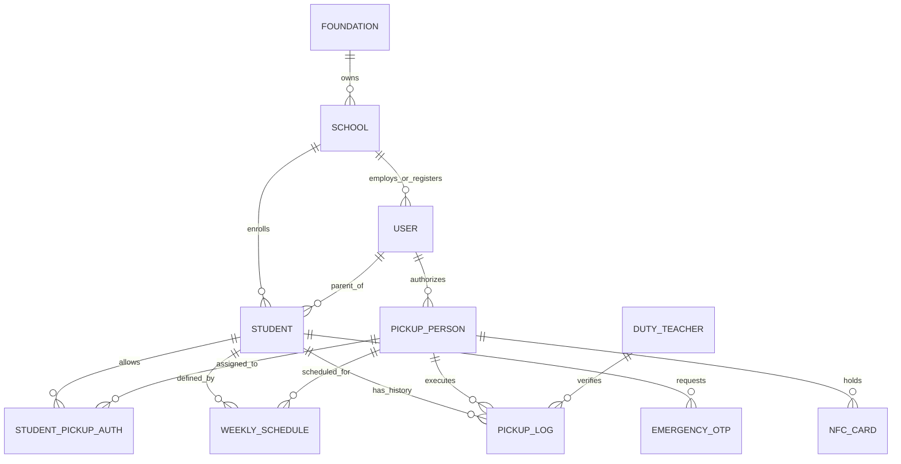

# Data Model: JemputAman - Sistem Verifikasi Penjemputan Anak PAUD/TK Berbasis Kartu NFC

## Entity Relationship Summary

---

## Entity Definitions

### 1. Foundation (Yayasan)
Mengelompokkan satu atau beberapa sekolah cabang di bawah satu entitas manajemen/langganan.

| Attribute | Type | Constraints | Description |
| :--- | :--- | :--- | :--- |
| `id` | UUID | Primary Key | Identifier unik yayasan |
| `name` | String | Not Null | Nama yayasan / pengelola |
| `subscription_tier` | Enum | `STARTER`, `PREMIUM_MULTI_SCHOOL` | Tier paket langganan SaaS |
| `created_at` | Timestamp | Default NOW | Waktu pendaftaran |

---

### 2. School (Sekolah / Tenant)
Entitas isolasi utama (multi-tenant context). Setiap transaksi terikat pada `school_id`.

| Attribute | Type | Constraints | Description |
| :--- | :--- | :--- | :--- |
| `id` | UUID | Primary Key | Identifier unik sekolah |
| `foundation_id` | UUID | Foreign Key $\rightarrow$ Foundation | Id yayasan pemilik (opsional) |
| `name` | String | Not Null | Nama PAUD / TK |
| `code` | String | Unique, Not Null | Kode unik sekolah (e.g. `TK-SALATIGA-01`) |
| `city` | String | Not Null | Kota lokasi sekolah (e.g., Salatiga, Semarang) |
| `status` | Enum | `ACTIVE`, `SUSPENDED` | Status langganan sekolah |
| `created_at` | Timestamp | Default NOW | Waktu pendaftaran |

---

### 3. User (Pengguna System)
Akun pengguna yang mencakup Admin Sekolah, Guru Piket, Orang Tua, dan Pengurus Yayasan.

| Attribute | Type | Constraints | Description |
| :--- | :--- | :--- | :--- |
| `id` | UUID | Primary Key | Identifier unik pengguna |
| `school_id` | UUID | Foreign Key $\rightarrow$ School | Tenant sekolah pengguna |
| `role` | Enum | `ADMIN`, `TEACHER`, `PARENT`, `FOUNDATION` | Hak akses pengguna |
| `full_name` | String | Not Null | Nama lengkap pengguna |
| `email` | String | Unique, Not Null | Alamat email utama |
| `phone_number` | String | Unique, Not Null | Nomor WhatsApp/HP untuk notifikasi |
| `password_hash` | String | Not Null | Hash kata sandi terenkripsi |
| `status` | Enum | `ACTIVE`, `INACTIVE` | Status akun |

---

### 4. Student (Siswa)
Data anak murid PAUD/TK yang dijemput.

| Attribute | Type | Constraints | Description |
| :--- | :--- | :--- | :--- |
| `id` | UUID | Primary Key | Identifier unik siswa |
| `school_id` | UUID | Foreign Key $\rightarrow$ School | Tenant sekolah siswa |
| `parent_id` | UUID | Foreign Key $\rightarrow$ User | Akun Orang Tua/Wali utama |
| `full_name` | String | Not Null | Nama lengkap anak |
| `class_name` | String | Not Null | Kelas/Kelompok (e.g., TK-A1, PAUD B) |
| `student_number` | String | Not Null | Nomor Induk Siswa (NIS) |
| `photo_url` | String | Nullable | URL foto profil siswa |
| `status` | Enum | `ACTIVE`, `GRADUATED`, `INACTIVE` | Status keaktifan siswa |

---

### 5. PickupPerson (Penjemput Terdaftar)
Individu yang diberi otorisasi oleh orang tua untuk menjemput anak (Ayah, Ibu, Supir, Kakek, Paman, dll).

| Attribute | Type | Constraints | Description |
| :--- | :--- | :--- | :--- |
| `id` | UUID | Primary Key | Identifier unik penjemput |
| `school_id` | UUID | Foreign Key $\rightarrow$ School | Tenant sekolah |
| `parent_id` | UUID | Foreign Key $\rightarrow$ User | Orang tua pemberi izin |
| `full_name` | String | Not Null | Nama lengkap penjemput |
| `relationship` | String | Not Null | Hubungan (e.g. Supir, Kakek, Ibu) |
| `phone_number` | String | Not Null | Nomor telp penjemput |
| `photo_url` | String | Nullable | URL foto verifikasi fisik penjemput |
| `status` | Enum | `ACTIVE`, `BLOCKED`, `INACTIVE` | Status kelayakan penjemput |

---

### 6. NFCCard (Kartu NFC Unik)
Kartu fisik NFC yang ditautkan ke penjemput resmi.

| Attribute | Type | Constraints | Description |
| :--- | :--- | :--- | :--- |
| `id` | UUID | Primary Key | Identifier unik registrasi kartu |
| `school_id` | UUID | Foreign Key $\rightarrow$ School | Tenant sekolah |
| `pickup_person_id` | UUID | Foreign Key $\rightarrow$ PickupPerson | Penjemput pemilik kartu |
| `card_uid` | String | Unique, Not Null | UID fisik hasil scan NFC Reader |
| `status` | Enum | `ACTIVE`, `INACTIVE`, `LOST` | Status keaktifan kartu |
| `issued_at` | Timestamp | Default NOW | Tanggal penyerahan kartu |

---

### 7. WeeklyPickupSchedule (Jadwal Penjemputan Mingguan)

| Attribute | Type | Constraints | Description |
| :--- | :--- | :--- | :--- |
| `id` | UUID | Primary Key | Identifier unik jadwal |
| `student_id` | UUID | Foreign Key $\rightarrow$ Student | Siswa sasaran |
| `pickup_person_id` | UUID | Foreign Key $\rightarrow$ PickupPerson | Penjemput sah untuk hari ini |
| `day_of_week` | Enum | `MON`, `TUE`, `WED`, `THU`, `FRI`, `SAT` | Hari berlaku jadwal |
| `time_start` | Time | Nullable | Jam mulai jendela kepulangan |
| `time_end` | Time | Nullable | Jam akhir jendela kepulangan |

---

### 8. PickupLog (Jejak Audit Penjemputan)
Catatan riwayat transaksi penjemputan anak di sekolah.

| Attribute | Type | Constraints | Description |
| :--- | :--- | :--- | :--- |
| `id` | UUID | Primary Key | Identifier log |
| `school_id` | UUID | Foreign Key $\rightarrow$ School | Tenant sekolah |
| `student_id` | UUID | Foreign Key $\rightarrow$ Student | Siswa yang dijemput |
| `pickup_person_id` | UUID | Nullable, Foreign Key | Penjemput yang hadir |
| `nfc_card_id` | UUID | Nullable, Foreign Key | Kartu NFC yang di-tap |
| `duty_teacher_id` | UUID | Foreign Key $\rightarrow$ User | Guru piket pemindai |
| `verification_method`| Enum | `NFC_TAP`, `EMERGENCY_OTP` | Metode verifikasi yang digunakan |
| `status` | Enum | `VERIFIED`, `OUT_OF_SCHEDULE`, `BLOCKED` | Hasil akhir verifikasi |
| `timestamp` | Timestamp | Default NOW | Waktu presisi pengetapan/verifikasi |
| `notes` | String | Nullable | Catatan khusus (misal: "Izin OTP Orang Tua") |

---

### 9. EmergencyOTP (Mode Darurat Lupa Kartu)

| Attribute | Type | Constraints | Description |
| :--- | :--- | :--- | :--- |
| `id` | UUID | Primary Key | Identifier OTP |
| `school_id` | UUID | Foreign Key $\rightarrow$ School | Tenant sekolah |
| `student_id` | UUID | Foreign Key $\rightarrow$ Student | Siswa yang dijemput |
| `pickup_person_id` | UUID | Foreign Key $\rightarrow$ PickupPerson | Penjemput tanpa kartu |
| `otp_code` | String | 6 Digits, Not Null | Kode OTP acak 6 angka |
| `status` | Enum | `PENDING`, `APPROVED`, `REJECTED`, `EXPIRED` | Status persetujuan orang tua |
| `expires_at` | Timestamp | Not Null | Batas waktu berlaku (10 menit) |
| `created_at` | Timestamp | Default NOW | Waktu pengajuan OTP |
